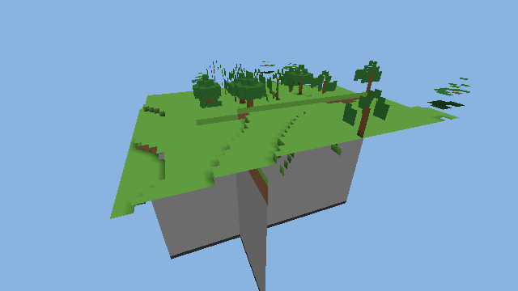

# PROJECT VOXELCORE

**Next-generation high-performance voxel engine — C++23, inspired by Horizon (Rust, MIT) as a functional and architectural reference.**

Status: **Stage 3–8 in progress** — working, tested engine foundation: palette-compressed world storage, deterministic terrain, an exact greedy mesher, frustum culling, heightfield LOD, a software CPU rasterizer (verification path), unit tests, benchmarks, and CI. GPU rendering (Vulkan) is designed but not yet claimed working. See `DEVELOPMENT_STATUS.md` for the honest ledger.



## Layout

```
voxelcore/            the C++23 engine (CMake + Ninja)
  engine/             core, memory, jobs, world, chunks, terrain, meshing, visibility, lod, rendering, …
  tools/voxelcore-cli headless verification driver (gen | mesh | render | lod)
  tests/              zero-dependency test runner (ctest)
  benchmarks/         CSV micro-benchmarks
docs/                 research, audit, decisions, plans (start with docs/REIMPLEMENTATION_PLAN.md)
scripts/fetch_horizon.sh   fetches the Horizon reference clone into ../horizon
.github/workflows/ci.yml   Linux build+test, ASan/UBSan, Android arm64-v8a compile check
```

## Build & run (Linux desktop)

Requirements: gcc ≥ 12 (or clang ≥ 16), cmake ≥ 3.21, ninja.

```bash
cmake -S voxelcore -B voxelcore/build -G Ninja -DCMAKE_BUILD_TYPE=Release
ninja -C voxelcore/build
./voxelcore/build/voxelcore_tests                 # 33,435 checks, 0 failures
./voxelcore/build/voxelcore_bench                 # CSV benchmarks
./voxelcore/build/voxelcore mesh /tmp/w 1234 1    # generate + mesh a 3×3-chunk world, print stats
./voxelcore/build/voxelcore render out.ppm 1234 1 640   # headless isometric render (PPM)
```

## Android

CI compile-checks the engine for `arm64-v8a` via the NDK (`android-arm64-build` job). A NativeActivity app is stage 12; nothing Android is claimed runnable yet.

## Relationship to Horizon

Horizon is an MIT-licensed Minecraft: Java Edition 26.3 rewrite in Rust. We study it deeply (see `docs/HORIZON_SOURCE_AUDIT.md`) but reimplement functionality in C++23 — no code is copied, no wgpu/naga dependency is imported, no Minecraft assets are used or distributed. Horizon is **not** vendored; `scripts/fetch_horizon.sh` re-clones it as read-only reference.

## Honesty policy

No claim without evidence: builds are run, tests are counted, benchmarks are committed, incompatibilities are documented, and unbuilt artifacts are never claimed. See `DEVELOPMENT_STATUS.md`, `BENCHMARK_HISTORY.md`, `REGRESSION_REPORT.md`.
